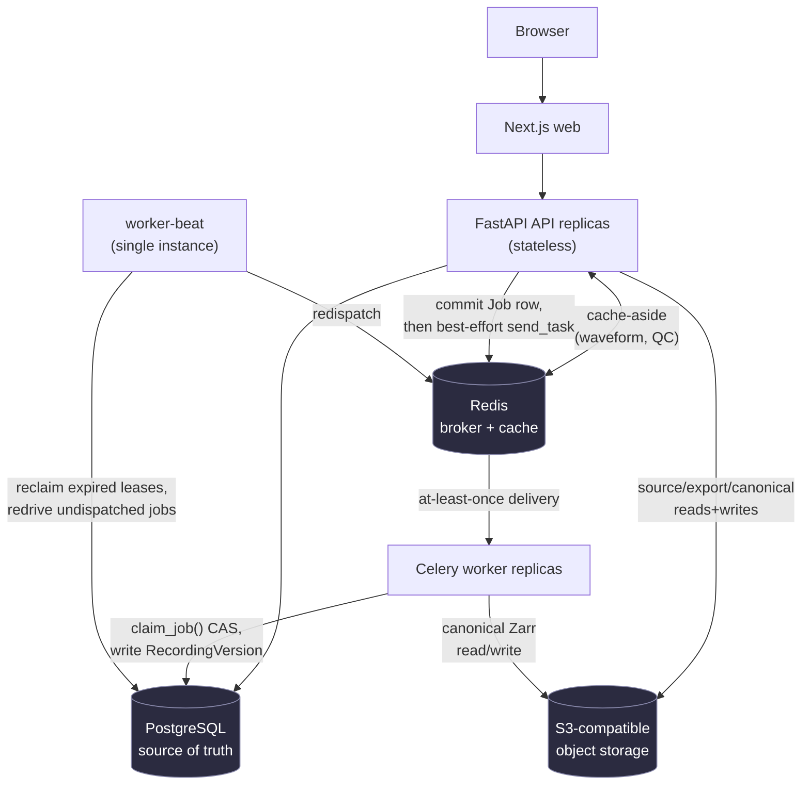

# NeuroWorkspace

A web-based workspace for reviewing, annotating, quality-checking, and
processing EEG recordings.

> Research software, not a medical device or diagnostic system. Do not upload
> identifiable or regulated health information — see
> [Limitations](#limitations).


## What it does

NeuroWorkspace lets a researcher or BCI developer upload an EEG recording,
scroll and zoom through it in the browser without downloading the whole
file, mark regions of interest, flag channels that look bad, review
automated quality heuristics, run a processing step (e.g. re-referencing)
without losing the original recording, and export the results — all inside
private, per-workspace storage that keeps each team's recordings and
annotations isolated from every other team's.

## Try it

```bash
git clone <this-repo> && cd neuro-workspace
cp .env.example .env
docker compose up --build
```

Open <http://localhost:3000> and choose **Try a sample EEG** — a checksum-pinned,
CC0 EEGLAB recording from OpenNeuro ds004362 v1.0.0, no account or upload
required. `docker compose down -v` tears the stack down, including volumes.
See [Quick start](#quick-start) for the native (non-Docker) dev path.

## Features

- **Upload EEG recordings** in several common formats directly from the
  browser, with progress and clear failure messages if a file is malformed.
- **Review long recordings without downloading them** — pan, zoom, and jump
  to a timestamp; the viewer only ever fetches the visible window.
- **Annotate** — mark a time region with a label and description, edit or
  delete it later, and see who changed what if two people edit the same
  annotation at once (you get a clear conflict prompt, never a silent
  overwrite).
- **Flag bad channels** during review, with your marks preserved across
  reloads and page revisits.
- **Inspect quality-control heuristics** (per-channel signal statistics and
  flags) — presented as review aids, not diagnostic conclusions.
- **Process a recording** (currently: average-reference) without touching
  the original — processing produces a new, separate version of the
  recording, so the source is always intact and the history of what was
  done is always visible.
- **Export** annotations, provenance, or QC results for a recording.
- **Organize work** into workspaces and projects, with each workspace's
  recordings, jobs, and annotations private to the people you add.

## Supported formats

Each row below is a real adapter exercised by an acceptance test against a
checksum-pinned public fixture — not just a claimed library capability.

| Format | Public acceptance source |
|---|---|
| EDF / EDF+ | PhysioNet Sleep-EDF Database Expanded 1.0.0 |
| BioSemi BDF | HBN-EEG Foundation Challenge R1 public BDF derivative |
| BrainVision | OpenNeuro ds006547 v1.0.0 |
| EEGLAB `.set` / optional `.fdt` | OpenNeuro ds004362 v1.0.0 |
| MNE FIF | Official `mne-tools/mne-testing-data` fixture |
| Configured CSV / TSV | Schema wizard and a generated acceptance fixture |
| BIDS EEG | Exercised via the OpenNeuro BrainVision subset |

Large public recordings stay outside Git and are fetched/checksum-verified on
demand via `scripts/fetch_test_data.py`; see
[docs/REAL_DATA_TEST_PLAN.md](docs/REAL_DATA_TEST_PLAN.md).

## Quick start

Requirements: Docker with Compose.

```bash
cp .env.example .env
docker compose up --build
```

This starts Postgres, Redis, MinIO, a one-shot `bootstrap` container
(migrations + sample seed), the API, worker, worker-beat, and the web app.
Open <http://localhost:3000> and choose **Try a sample EEG**, or sign in with
dev auth and upload your own file. `docker compose down -v` stops everything
and removes volumes (full reset); `docker compose down` alone keeps data.

For native development (Python 3.12-3.13, Node 20+, pnpm, uv) without Docker:

```bash
make install
cp .env.example .env
# in .env: use SQLite, local object storage, and WORKER_EAGER=true
make migrate
make seed            # or `make seed-synthetic` for a no-network fallback
make dev             # prints the API/web/worker commands to run
```

## Developer commands

```bash
make lint            # Python + frontend linters
make typecheck       # mypy + tsc
make test            # fast unit/integration suite (Python + web)
make test-e2e        # Playwright browser tests
make real-data       # fetch + run acceptance tests against real public EEG files
make test-s3         # opt-in: exercises S3ZarrSignalStore against a real MinIO
make helm-lint        # client-side Helm chart lint (no cluster needed)
make helm-template    # render the Helm chart to plain manifests
make benchmark        # 32-channel/30-minute local-store stress benchmark
```

See [CONTRIBUTING.md](CONTRIBUTING.md) for the full developer workflow.

## Architecture

Next.js renders the viewer; FastAPI handles authorization and metadata;
Celery workers do the scientific parsing/processing; PostgreSQL is the
single source of truth; Redis is a cache and message broker only; signal
data lives in S3-compatible object storage as chunked Zarr arrays so any
stateless replica can read/write it directly.



A few of the choices behind this shape, briefly:

- **A modular monolith, not microservices** — one Next.js app, one FastAPI
  app, one Celery worker sharing a domain package. Nothing about this
  product's current scale justifies independently-deployed services, and
  keeping "create a Recording and its ingestion Job" one transaction is
  simpler than a distributed saga. ([ADR 0001](docs/adr/0001-monorepo-modular-monolith.md))
- **Signal arrays live in object storage, not Postgres** — large,
  chunk-accessed data belongs somewhere built for that access pattern, not
  in the relational store used for metadata and authorization.
  ([ADR 0002](docs/adr/0002-canonical-signal-storage.md),
  [ADR 0007](docs/adr/0007-object-store-canonical-signal-storage.md))
- **Processing never mutates a recording in place** — a transformation
  produces a new, immutable version with a link to its parent, so the
  original is never at risk and the history of what was done is always
  reconstructable.
- **Job delivery is at-least-once; job effects are effectively-once** — a
  single conditional database update makes a duplicate task delivery a
  no-op, which is simpler to reason about than requiring exactly-once
  delivery from the broker itself. ([ADR 0004](docs/adr/0004-job-queue.md))

For the deep mechanism-by-mechanism walkthrough (job recovery, versioning,
concurrency control, tenant isolation) with the evidence behind each claim,
see [docs/ARCHITECTURE.md](docs/ARCHITECTURE.md). For measured performance,
see [docs/PERFORMANCE.md](docs/PERFORMANCE.md).

## Deployment

`docker-compose.yml` is the single-machine path. A Helm chart at
[`deploy/helm/neuroworkspace`](deploy/helm/neuroworkspace) is the
Kubernetes path. Both are covered in [docs/DEPLOYMENT.md](docs/DEPLOYMENT.md),
including configuration, migrations, and scaling; see
[docs/VALIDATION.md](docs/VALIDATION.md) for exactly what's been verified
about each (short version: a real local `kind` cluster, install/upgrade,
and 1/2/3-replica scaling have been exercised; a production-grade cluster
and the externally-provisioned Postgres/Redis/S3 path have not).

## Security and privacy

Report suspected vulnerabilities through [SECURITY.md](SECURITY.md), not a
public issue. See [docs/THREAT_MODEL.md](docs/THREAT_MODEL.md) for trust
boundaries and mitigations, and
[docs/HIPAA_GAP_ANALYSIS.md](docs/HIPAA_GAP_ANALYSIS.md) for what would be
required before this software could handle PHI (it does not today). Source
files, raw samples, filenames, and annotation contents are excluded from
product analytics.

## Documentation

| Document | What it covers |
|---|---|
| [docs/ARCHITECTURE.md](docs/ARCHITECTURE.md) | Repository layout, component overview, and a deep walkthrough of job recovery, versioning, concurrency, and tenant isolation, with evidence |
| [docs/DATA_MODEL.md](docs/DATA_MODEL.md) | Schema and entity relationships |
| [docs/PERFORMANCE.md](docs/PERFORMANCE.md) | Benchmark methodology, environment, and every measured number |
| [docs/VALIDATION.md](docs/VALIDATION.md) | Index of what's been verified against a running system, and what hasn't |
| [docs/DEPLOYMENT.md](docs/DEPLOYMENT.md) | Docker Compose and Kubernetes, configuration, migrations, scaling, backups |
| [docs/THREAT_MODEL.md](docs/THREAT_MODEL.md) | Trust boundaries, assets, mitigations |
| [docs/HIPAA_GAP_ANALYSIS.md](docs/HIPAA_GAP_ANALYSIS.md) | What's required before handling PHI (not supported today) |
| [docs/OBSERVABILITY.md](docs/OBSERVABILITY.md) | Metrics, logging, and the optional Prometheus profile |
| [docs/adr/](docs/adr/) | Architecture decision records |
| [docs/API.md](docs/API.md) | API surface and conventions |
| [docs/archive/](docs/archive/) | Superseded planning/milestone documents, kept for history |

## Limitations

- **Research alpha, not a medical device.** Not for clinical use or PHI —
  see [docs/HIPAA_GAP_ANALYSIS.md](docs/HIPAA_GAP_ANALYSIS.md).
- **No production-cloud deployment has been done.** Kubernetes validation is
  against a local `kind` cluster only; no EKS/GKE/AKS run, no externally
  provisioned Postgres/Redis/S3 path exercised end to end.
- **The shipped API image runs a single process**, which is the measured
  concurrency bottleneck under load — see
  [docs/PERFORMANCE.md](docs/PERFORMANCE.md).
- **All performance numbers are single-machine, Docker/MinIO measurements**
  — not a production capacity claim; see "Limits of the benchmarks" in
  [docs/PERFORMANCE.md](docs/PERFORMANCE.md).
- **No backup automation is implemented** — only a documented manual
  procedure; see "Backups" in [docs/DEPLOYMENT.md](docs/DEPLOYMENT.md).
- **Frontend/product gaps remain**: no admin UI (equivalent operations are
  API/CLI-only), no queue-depth-based autoscaling signal, no Grafana
  dashboards shipped (Prometheus scrape only), no workspace member
  management UI (API-only).
- **A stale annotation/bad-channel write asks the user to reapply their
  change manually** rather than attempting an automatic merge.
- **No formal external security audit has been performed.**

## Contributing

Read [CONTRIBUTING.md](CONTRIBUTING.md), [CODE_OF_CONDUCT.md](CODE_OF_CONDUCT.md),
and the relevant ADR before changing a core contract. New format claims require a
license-reviewed, checksum-pinned public file plus independent acceptance tests.

## License

Apache-2.0. External datasets retain their own terms.
