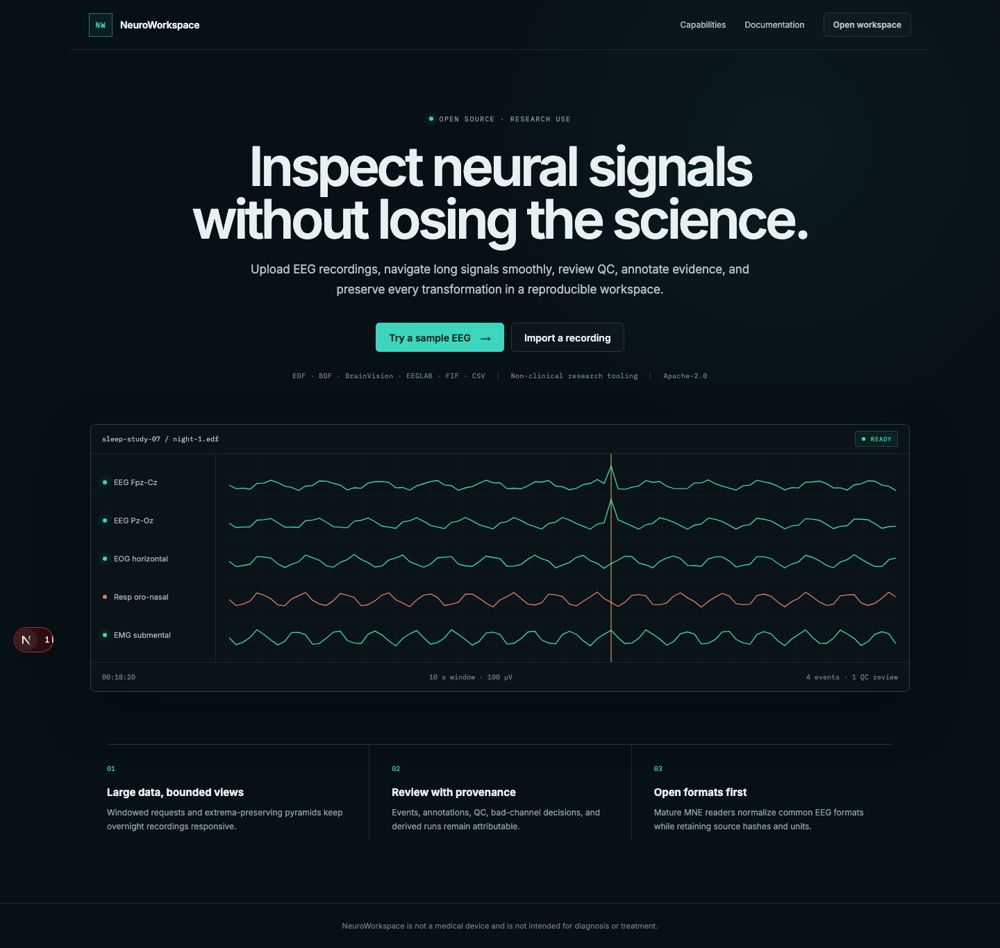

# NeuroWorkspace

NeuroWorkspace is an open-source, web-first workspace for inspecting, annotating,
quality-reviewing, and reproducibly processing neural and physiological recordings.
The alpha centers EEG and keeps original files immutable. It is a research and
engineering tool—not a medical device or diagnostic system.

> Current status: active alpha implementation. Compatibility and performance are
> reported only when exercised against pinned public data. See the readiness report
> before relying on a format.



## What it is for

- Open EDF/EDF+, BioSemi BDF, BrainVision, EEGLAB, FIF, or configured CSV data.
- Inspect recording metadata and navigate long multichannel waveforms without
  loading the recording into the browser.
- Review imported events, create attributed annotations, and confirm bad channels.
- Inspect transparent QC heuristics separately from human decisions.
- Create immutable, versioned processing runs and export useful artifacts.
- Collaborate within workspace-scoped projects with explicit authorization.

The first screen offers **Try sample recording** and **Upload recording**. The
sample path uses an attributed public/synthetic artifact and requires no private
upload.

## Architecture

Next.js renders a Canvas waveform viewer. FastAPI serves workspace resources and
viewport-sized waveform envelopes. Celery workers use MNE for scientific I/O,
write immutable Zarr arrays/pyramids to a shared durable volume in the first Docker
deployment, and keep job state/provenance in PostgreSQL. Source uploads and exports
use private S3-compatible storage; Redis delivers jobs. A fully object-native
canonical Zarr backend remains a documented scale-out item.

See [technical design](docs/TECH_DESIGN.md), [data model](docs/DATA_MODEL.md),
[viewer design](docs/VIEWER_DESIGN.md), [threat model](docs/THREAT_MODEL.md), and
[measured alpha-readiness report](docs/ALPHA_READINESS_REPORT.md).

## Quickstart

Requirements: Docker with Compose, or Node 20+, pnpm 11, Python 3.12-3.13, and uv.

```bash
cp .env.example .env
docker compose up --build
```

Then open <http://localhost:3000>. For native development:

```bash
make install
make migrate
make seed
make dev
```

Run the quality gates:

```bash
make lint
make typecheck
make test
make build
```

## Format support

| Format | Planned P0 | Real-data acceptance |
|---|---:|---|
| EDF / EDF+ | yes | PhysioNet Sleep-EDF Expanded 1.0.0 |
| BioSemi BDF | yes | HBN-EEG challenge R1 public BDF derivative |
| BrainVision `.vhdr/.vmrk/.eeg` | yes | OpenNeuro ds006547 v1.0.0 |
| EEGLAB `.set` / optional `.fdt` | yes | OpenNeuro ds004362 v1.0.0 |
| MNE FIF | yes | official MNE testing-data fixture |
| configured CSV/TSV | yes | schema wizard and generated fixture |
| BIDS EEG dataset | foundation/P1 | OpenNeuro ds004362 subset via MNE-BIDS |

No table cell implies untested compatibility. Fetch scripts keep large recordings
outside Git and verify checksums; see [real-data plan](docs/REAL_DATA_TEST_PLAN.md).

## Data and privacy boundary

Do not upload identifiable or regulated health data to an alpha deployment. The
software does not claim HIPAA compliance and QC flags are automated suggestions for
review, not medical conclusions. Signal data is never sent to external AI services
or used for model training. See [security/privacy](docs/SECURITY_PRIVACY.md) and
[HIPAA gaps](docs/HIPAA_GAP_ANALYSIS.md).

## Contributing

Read [CONTRIBUTING.md](CONTRIBUTING.md), the [roadmap](docs/ROADMAP.md), and the
relevant ADR before changing a core contract. New format claims require a public,
license-reviewed, checksum-pinned real file plus tests. Security issues should be
reported through [SECURITY.md](SECURITY.md), not a public issue.

The code is licensed under Apache-2.0; external datasets retain their own terms.
