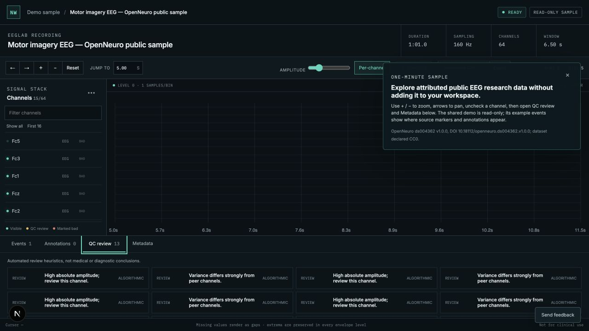

# NeuroWorkspace

A modern open-source workspace for inspecting, annotating, quality-reviewing, and
organizing EEG recordings.



NeuroWorkspace is for EEG researchers, BCI developers, and neurotechnology teams
who need to review long recordings without giving up source hashes, units,
annotations, or processing provenance. It is research software, not a medical
device or diagnostic system.

**Hosted alpha:** no public URL has been published yet. A deployment operator adds
the URL after completing the [public-alpha deployment gates](docs/PUBLIC_ALPHA_DEPLOYMENT.md).

## Try Sample EEG

The homepage opens a shared, read-only recording with no account or upload. The
sample is a checksum-pinned EEGLAB recording from OpenNeuro ds004362 v1.0.0
(DOI 10.18112/openneuro.ds004362.v1.0.0), whose dataset declares CC0. Attribution
and limitations stay visible in the workspace. Within a minute, a visitor can
zoom, pan, toggle channels, inspect a source event, read metadata, and review
non-diagnostic QC suggestions.

## Start locally

Requirements: Docker with Compose. Copy the example configuration, replace the
local placeholder secrets, then start the six-service stack:

```bash
cp .env.example .env
docker compose up --build
```

Open <http://localhost:3000> and choose **Try a sample EEG**. Docker execution could
not be repeated on the workstation used for this release preparation, so operators
must run the exact container and restart checks in
[PUBLIC_ALPHA_DEPLOYMENT.md](docs/PUBLIC_ALPHA_DEPLOYMENT.md) before inviting users.

For native development with Python 3.12–3.13, Node 20+, pnpm 11, and uv:

```bash
make install
cp .env.example .env
# In .env use SQLite, local object storage, and WORKER_EAGER=true.
make migrate
make seed
make dev
```

`make dev` prints the API, web, and worker commands to run in separate terminals.
`make seed-synthetic` is the offline, no-human-data fallback.

## Supported formats

| Format | Public acceptance source |
|---|---|
| EDF / EDF+ | PhysioNet Sleep-EDF Expanded 1.0.0 |
| BioSemi BDF | HBN-EEG challenge R1 public BDF derivative |
| BrainVision | OpenNeuro ds006547 v1.0.0 |
| EEGLAB `.set` / optional `.fdt` | OpenNeuro ds004362 v1.0.0 |
| MNE FIF | Official MNE testing-data fixture |
| Configured CSV / TSV | Schema wizard and generated acceptance fixture |
| BIDS EEG | Foundation exercised with the OpenNeuro BrainVision subset |

These are tested compatibility claims, not support for every producer variant.
Large public recordings remain outside Git and are checksum-verified through
`testdata/manifest.yaml`; see the [real-data plan](docs/REAL_DATA_TEST_PLAN.md).

## What the alpha supports

- private workspace → project → recording organization;
- immutable source uploads and durable background ingestion;
- viewport-bounded Canvas waveform navigation for long recordings;
- imported events, attributed annotations, and manual bad-channel decisions;
- transparent QC heuristics kept separate from human review;
- immutable processing runs and annotations/QC/provenance exports;
- returning to existing recordings through **Open workspace**;
- privacy-bounded product evidence and in-app feedback.

Source files, raw samples, filenames, subject fields, clinical notes, and annotation
contents are excluded from product analytics. Do not upload identifiable or
regulated health information to a public alpha. The software does not claim HIPAA
compliance, and it does not send signal data to external AI services.

## Architecture and deployment

Next.js renders the viewer. FastAPI applies workspace authorization and serves
bounded envelopes. Celery workers use MNE, write immutable Zarr arrays and
pyramids, and persist job/provenance state in PostgreSQL. Source uploads and exports
use private S3-compatible storage; Redis is a broker, not a source of truth.

The current canonical Zarr store is a shared POSIX filesystem. Every API and worker
replica must mount the same durable network volume; S3 alone is not sufficient for
canonical data in v0.1.0-alpha. Read the
[technical design](docs/TECH_DESIGN.md), [deployment guide](docs/PUBLIC_ALPHA_DEPLOYMENT.md),
[analytics contract](docs/PRODUCT_ANALYTICS.md), and
[public-alpha report](docs/USER_READY_ALPHA_REPORT.md).

## Development and verification

```bash
make lint
make typecheck
make test
make test-e2e
make build
make real-data
```

CI also checks migrations, Python and JavaScript dependency advisories, container
builds, and the pinned real-data matrix. Product-media capture is reproducible with
`pnpm --filter @neuroworkspace/web media:capture`; see
[PRODUCT_MEDIA.md](docs/PRODUCT_MEDIA.md).

## Contributing and security

Read [CONTRIBUTING.md](CONTRIBUTING.md), [CODE_OF_CONDUCT.md](CODE_OF_CONDUCT.md),
and the relevant ADR before changing a core contract. New format claims require a
license-reviewed, checksum-pinned public file plus independent acceptance tests.
Report suspected vulnerabilities through [SECURITY.md](SECURITY.md), not a public
issue.

The code is licensed under Apache-2.0. External datasets retain their own terms.
