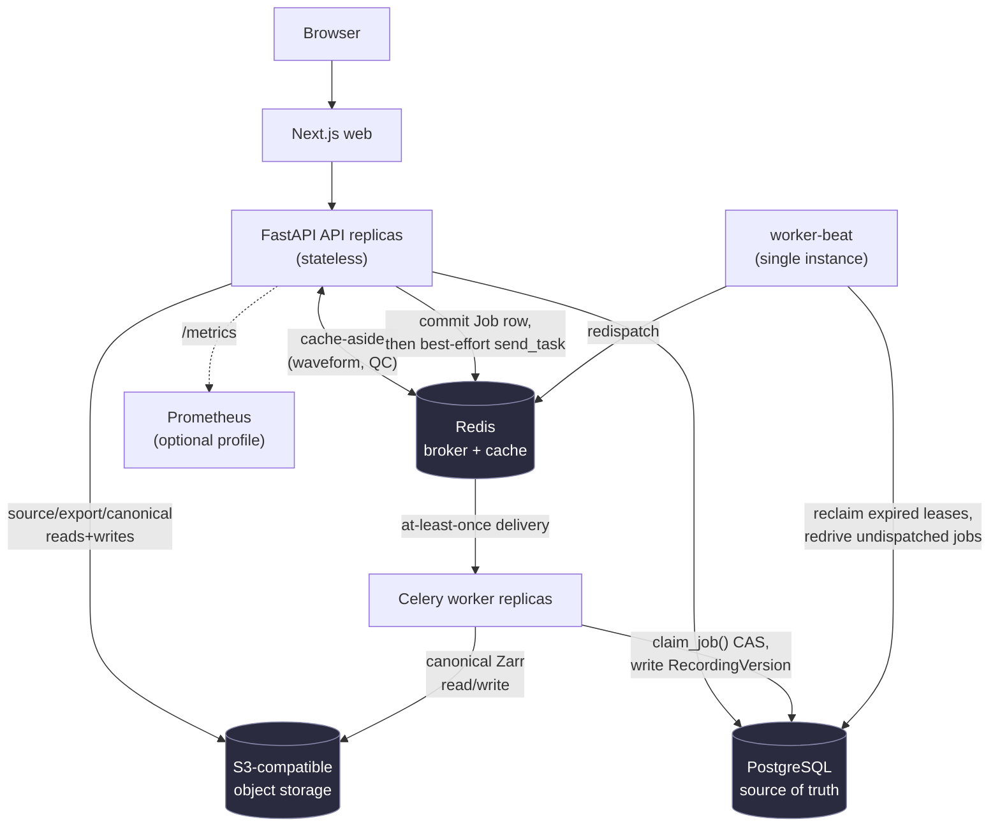
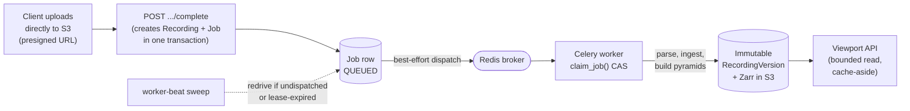

# NeuroWorkspace

A workspace for inspecting, annotating, quality-reviewing, and organizing EEG
recordings, built around durable job processing, immutable versioned signal
storage, and viewport-bounded rendering of arbitrarily long recordings.

> Research software, not a medical device or diagnostic system. Do not upload
> identifiable or regulated health information — see
> [Current limitations](#current-limitations).


## Try it

```bash
git clone <this-repo> && cd neuro-workspace
cp .env.example .env
docker compose up --build
```

Open <http://localhost:3000> and choose **Try a sample EEG** — a checksum-pinned,
CC0 EEGLAB recording from OpenNeuro ds004362 v1.0.0, no account or upload
required. `docker compose down -v` tears the stack down, including volumes.
See [Quick start](#quick-start) for the native (non-Docker) dev path and what
each service is.

## Technical highlights

Properties below are all implemented and exercised by the tests/benchmarks
linked next to each one — this list intentionally excludes anything aspirational.

- **Immutable, versioned processing lineage.** A transformation (e.g.
  average-reference) never mutates a recording's signal data; it produces a
  new `RecordingVersion` with a `parent_version_id`, so lineage is always
  reconstructable. ([ADR 0002](docs/adr/0002-canonical-signal-storage.md))
- **S3-backed, chunked Zarr signal storage.** Canonical signal arrays and
  multi-resolution pyramids live in S3-compatible object storage as
  per-(channel, time-chunk) objects — no shared POSIX volume, no single
  node holding recording data. ([ADR 0007](docs/adr/0007-object-store-canonical-signal-storage.md))
- **Viewport-bounded waveform retrieval**, independent of recording length. An
  identical 10s/2-channel request against 30-second, 5-minute, and 30-minute
  recordings measured at the same ~7-8ms once warm — see
  [benchmarks](#measured-performance).
- **Multi-tenant capability authorization.** Every query and object/signing
  operation is scoped through active workspace membership; missing and
  unauthorized resources return the same response so existence can't be
  probed. ([ADR 0005](docs/adr/0005-authentication-authorization.md))
- **Optimistic concurrency on shared mutable state.** Annotations and
  bad-channel review both use revision-based compare-and-swap: a stale write
  gets a `409` conflict, never a silent overwrite. See
  [Reliability](#reliability).
- **Effectively-once asynchronous processing over an at-least-once broker.**
  A single conditional `UPDATE` (`claim_job()`) makes duplicate Celery
  delivery a no-op — proven at 32,000 concurrent claim attempts with zero
  double-claims. See [benchmarks](#measured-performance).
- **Worker lease/heartbeat recovery.** A crashed worker's job is detected via
  lease expiry and automatically redriven by `worker-beat`, no manual
  intervention. See [Reliability](#reliability).
- **Keyset (cursor) pagination that doesn't degrade with depth.** Walking
  60,002 rows across 301 pages measured 2.55-40.30ms/page with no growth
  trend. See [benchmarks](#measured-performance).
- **Horizontally stateless API.** No server-side session store, no
  replica-local cache of mutable state — proven by running two independent
  API containers and confirming identical behavior from both.
- **Real EEG format support**, each backed by a checksum-pinned public
  fixture and an acceptance test, not just a library claim — see
  [Supported formats](#supported-formats).

## Architecture



PostgreSQL is the single source of truth for metadata, lineage, authorization,
job state, and annotations. Redis is a cache and broker only — nothing lives
there that can't be reconstructed from Postgres/S3. Every component above is
horizontally replicable except `worker-beat`, which runs as one instance by
design (see [Design decisions](#design-decisions)).

**Upload → viewable recording**, the path most worth tracing end to end:



The gap between "Job row committed" and "worker picks it up" is a
transactional outbox, not a hope that the broker delivers: the database
commit is what actually durably records that the work exists (see
[ADR 0004](docs/adr/0004-job-queue.md)).

## Design decisions

Short version of why each major choice was made, not just what it is.

- **Modular monolith, not microservices** ([ADR 0001](docs/adr/0001-monorepo-modular-monolith.md)).
  One Next.js app, one FastAPI app, one Celery worker, deployed as separate
  processes from a shared domain package. There was no user-scale evidence
  justifying independently-owned services, and a monolith keeps transactions
  (e.g. "create Recording + Job atomically") trivial instead of requiring
  distributed-transaction or saga machinery.
- **PostgreSQL for everything relational**: metadata, lineage, authorization,
  job state, annotations. It's the one place correctness under concurrency
  (compare-and-swap updates, unique constraints) is cheap to get right, and
  it's queryable/auditable in ways a document or key-value store isn't.
- **Signal arrays live in object storage, not Postgres.** A recording's raw
  samples are large, append-mostly, and read via bounded byte-range/chunk
  access — the opposite access pattern from relational metadata. Storing
  them in S3-compatible object storage as chunked Zarr keeps Postgres small
  and fast, and lets any stateless replica read/write signal data over plain
  HTTP with no shared filesystem.
- **RecordingVersions are immutable; transformations create new ones, never
  mutate in place.** This makes lineage a directed graph you can always
  reconstruct (`parent_version_id`), makes caching trivially correct (an
  immutable key never needs invalidation, only a TTL), and means a
  processing bug can't silently corrupt the only copy of a recording's data.
- **Cursor (keyset) pagination, not `OFFSET`.** A cursor is anchored to
  `(sort_value, id)`, not a row count, so a row inserted anywhere in the
  table after a page was fetched can't shift already-issued cursors the way
  it would with `OFFSET n`. Measured to not degrade with depth — see
  [benchmarks](#measured-performance).
- **Optimistic concurrency (revision-based CAS) for annotations and
  bad-channel review**, not locking. Two users editing the same annotation
  is expected, not exceptional; a `409` with the current state is cheaper to
  build and reason about than distributed locks, and it surfaces the
  conflict to a human instead of silently picking a winner.
- **At-least-once job delivery, made effectively-once by database state.**
  Celery/Redis only need to guarantee "this message probably got delivered
  at least once" — the actual exactly-once *effect* comes from
  `claim_job()`'s single conditional `UPDATE`, which is cheaper to reason
  about than exactly-once delivery semantics at the broker layer.
- **Zarr chunking + multi-resolution pyramids bound viewport reads.** A
  waveform request only ever touches the handful of chunks covering the
  requested channel/time range, at the pyramid level appropriate to the
  requested pixel width — never the full recording, regardless of how long
  it is.

## Measured performance

Every number below was actually run against a live Docker Compose stack on a
single developer machine — full methodology, environment specs, and raw
`EXPLAIN` output are in [docs/PERFORMANCE.md](docs/PERFORMANCE.md).
**These are development-machine Docker/MinIO results and are not
production-cloud capacity claims.**

| Measurement | Result |
|---|---|
| Hot-path DB queries against an 8.4M-row dataset (5.0M `qc_metrics`, 801K `annotations`) | p50 0.14-0.60ms, p95 under 0.75ms, every query an index scan — no sequential scan observed |
| Cursor pagination, 60,002 rows across 301 pages (limit 200) | 2.55-40.30ms/page, no growth with depth |
| Concurrent job claims, 32,000 attempts (16 workers × 2,000 already-running jobs) | 0 jobs claimed more than once |
| Connection-pool fix (16 concurrent DB-touching threads) | max latency 2,139.74ms → 68.20ms (31x) after explicit pool sizing |
| Waveform viewport latency vs. recording length (10s/2ch request) | ~7-8ms warm, flat across 30s / 5min / 30min recordings |
| Real end-to-end processing (average-reference, 30min/32ch/256Hz, real Celery worker) | 6.67s from submit to `SUCCEEDED`, including writing an 85MiB Zarr version to S3 |
| Local-store stress benchmark (128ch × 7200s × 256Hz) | ingestion (write + full pyramid generation) in 29.089s |

The one real bottleneck found: a single, unconfigured uvicorn process is
CPU-bound under concurrent HTTP load (measured 257% CPU while Postgres sat at
2-3%) — the fix is running more processes/replicas, which the architecture
already supports, not a code change. See
[docs/PERFORMANCE.md](docs/PERFORMANCE.md) for the full bottleneck ranking
and the load-test numbers behind it.

## Reliability

Each scenario below was reproduced against the live stack (killed containers,
duplicated messages, disconnected dependencies) — not just reasoned about.
Full transcripts in [docs/RUNTIME_VALIDATION.md](docs/RUNTIME_VALIDATION.md).

| Scenario | Behavior |
|---|---|
| Duplicate HTTP mutation (retried `Idempotency-Key`) | First call creates; retry returns the same resource, no duplicate row |
| Duplicate Celery task delivery | First message does the work; the second is refused by `claim_job()`'s CAS in ~5ms |
| Concurrent annotation/bad-channel update | One write succeeds; the other gets `409` with current state, never a silent overwrite |
| Worker killed mid-job | Job's lease expires; `worker-beat` reclaims and redrives it within one sweep tick, no duplicate `RecordingVersion` |
| Redis (broker) outage | Reads still succeed (cache fails open); new jobs commit `QUEUED` and are redriven once Redis returns |
| Object-store (MinIO/S3) outage | Requests that need it return a structured `500`/`503`, not a bare crash |
| Postgres outage | `/health/ready` reports a clean `503`; recovers automatically via `pool_pre_ping` once Postgres returns |

## Kubernetes

The [Helm chart](deploy/helm/neuroworkspace) at `deploy/helm/neuroworkspace`
has been installed and exercised against a **real local `kind` cluster**: a
clean `helm install`, a real `helm upgrade` that preserved existing Postgres
data, and horizontal scaling of the API Deployment to 2 and 3 replicas with
the full application workflow verified stateless across them. That pass
found and fixed real bugs `helm lint`/`helm template` alone could not have
caught. **This is not a claim of production-readiness** — see
[docs/KUBERNETES_VALIDATION.md](docs/KUBERNETES_VALIDATION.md) for exactly
what was run and what wasn't:

- Validated: real `kind` cluster, real install/upgrade, 1/2/3 API replicas
  with stateless cross-replica behavior, data persisted across an upgrade,
  seven real Kubernetes-specific bugs found and fixed.
- Not validated: any production-grade cluster (EKS/GKE/AKS), the external
  Postgres/Redis/S3 (non-dev) path end to end, sustained high-concurrency
  load (cut short by host resource contention from running the cluster and
  the Compose stack on one machine), and the HPA's autoscaling cycle under
  live load.

See [docs/KUBERNETES.md](docs/KUBERNETES.md) for the chart's topology and
what it deliberately does not do (egress policy, queue-depth autoscaling,
worker metrics).

## Supported formats

Each row below is a real adapter exercised by an acceptance test against a
checksum-pinned public fixture (`testdata/manifest.yaml`), not just a claimed
library capability.

| Format | Public acceptance source |
|---|---|
| EDF / EDF+ | PhysioNet Sleep-EDF Database Expanded 1.0.0 |
| BioSemi BDF | HBN-EEG Foundation Challenge R1 public BDF derivative |
| BrainVision | OpenNeuro ds006547 v1.0.0 |
| EEGLAB `.set` / optional `.fdt` | OpenNeuro ds004362 v1.0.0 |
| MNE FIF | Official `mne-tools/mne-testing-data` fixture |
| Configured CSV / TSV | Schema wizard and a generated acceptance fixture |
| BIDS EEG | Exercised via the OpenNeuro BrainVision subset |

Large public recordings stay outside Git and are fetched/checksum-verified on
demand via `scripts/fetch_test_data.py`; see
[docs/REAL_DATA_TEST_PLAN.md](docs/REAL_DATA_TEST_PLAN.md).

## Quick start

Requirements: Docker with Compose.

```bash
cp .env.example .env
docker compose up --build
```

This starts Postgres, Redis, MinIO, a one-shot `bootstrap` container
(migrations + sample seed), the API, worker, worker-beat, and the web app.
Open <http://localhost:3000> and choose **Try a sample EEG**, or sign in with
dev auth and upload your own file. `docker compose down -v` stops everything
and removes volumes (full reset); `docker compose down` alone keeps data.

For native development (Python 3.12-3.13, Node 20+, pnpm, uv) without Docker:

```bash
make install
cp .env.example .env
# in .env: use SQLite, local object storage, and WORKER_EAGER=true
make migrate
make seed            # or `make seed-synthetic` for a no-network fallback
make dev             # prints the API/web/worker commands to run
```

## Developer commands

```bash
make lint            # Python + frontend linters
make typecheck       # mypy + tsc
make test            # fast unit/integration suite (Python + web)
make test-e2e        # Playwright browser tests
make real-data       # fetch + run acceptance tests against real public EEG files
make test-s3         # opt-in: exercises S3ZarrSignalStore against a real MinIO
make helm-lint        # client-side Helm chart lint (no cluster needed)
make helm-template    # render the Helm chart to plain manifests
make benchmark        # 32-channel/30-minute local-store stress benchmark
```

Load testing (`scripts/loadtest.js`, k6) and the database benchmark scripts
(`scripts/bench_*.py`) used to produce [docs/PERFORMANCE.md](docs/PERFORMANCE.md)
are documented there, including exact reproduction commands.

## Documentation

| Document | What it covers |
|---|---|
| [docs/ENGINEERING_TOUR.md](docs/ENGINEERING_TOUR.md) | Interview-oriented walk through the hardest engineering problems and where the answers live in the code |
| [docs/PERFORMANCE.md](docs/PERFORMANCE.md) | Full benchmark methodology, environment, raw `EXPLAIN` output, and every measured number |
| [docs/RUNTIME_VALIDATION.md](docs/RUNTIME_VALIDATION.md) | Live failure-injection results (crashed workers, dependency outages, duplicate delivery) |
| [docs/KUBERNETES_VALIDATION.md](docs/KUBERNETES_VALIDATION.md) | What was actually proven against a real `kind` cluster, bugs found and fixed |
| [docs/KUBERNETES.md](docs/KUBERNETES.md) | Helm chart topology, what it deliberately doesn't do, and why |
| [docs/TECH_DESIGN.md](docs/TECH_DESIGN.md) | System design overview |
| [docs/DATA_MODEL.md](docs/DATA_MODEL.md) | Schema and entity relationships |
| [docs/THREAT_MODEL.md](docs/THREAT_MODEL.md) | STRIDE-style threat model, trust boundaries, assets |
| [docs/HIPAA_GAP_ANALYSIS.md](docs/HIPAA_GAP_ANALYSIS.md) | What would be required before handling PHI (currently not supported) |
| [docs/OBSERVABILITY.md](docs/OBSERVABILITY.md) | Metrics, logging, and the optional Prometheus profile |
| [docs/adr/](docs/adr/) | Architecture decision records (numbered, see [Design decisions](#design-decisions)) |
| [docs/API.md](docs/API.md) | API surface and conventions |
| [docs/PUBLIC_ALPHA_DEPLOYMENT.md](docs/PUBLIC_ALPHA_DEPLOYMENT.md) | Gates for standing up a public hosted instance |

## Current limitations

- **Research alpha, not a medical device.** Not for clinical use or PHI —
  see [docs/HIPAA_GAP_ANALYSIS.md](docs/HIPAA_GAP_ANALYSIS.md).
- **No production-cloud deployment has been done.** Kubernetes validation is
  against a local `kind` cluster only; no EKS/GKE/AKS run, no externally
  provisioned Postgres/Redis/S3 path exercised end to end. See
  [Kubernetes](#kubernetes).
- **The API's HPA autoscaling cycle has not been exercised under live load**
  — replica *count* changes (1/2/3, manually) were verified stateless, but
  triggering a scale-up/down via real CPU load on a cluster was not.
- **All performance numbers are single-machine, Docker/MinIO measurements**
  — see "Limits of the benchmarks" in
  [docs/PERFORMANCE.md](docs/PERFORMANCE.md) before treating any number as a
  capacity claim.
- **Frontend/product gaps remain**: no admin surface, no queue-depth-based
  autoscaling signal, no Grafana dashboards shipped (Prometheus scrape only).
- **`BadChannel` and `Annotation` concurrency is proven correct under real
  concurrent Postgres sessions; a stale-write UX still asks the user to
  reapply a change manually** rather than attempting an automatic merge.

## Contributing and security

Read [CONTRIBUTING.md](CONTRIBUTING.md), [CODE_OF_CONDUCT.md](CODE_OF_CONDUCT.md),
and the relevant ADR before changing a core contract. New format claims require a
license-reviewed, checksum-pinned public file plus independent acceptance tests.
Report suspected vulnerabilities through [SECURITY.md](SECURITY.md), not a public
issue.

The code is licensed under Apache-2.0. External datasets retain their own terms.
