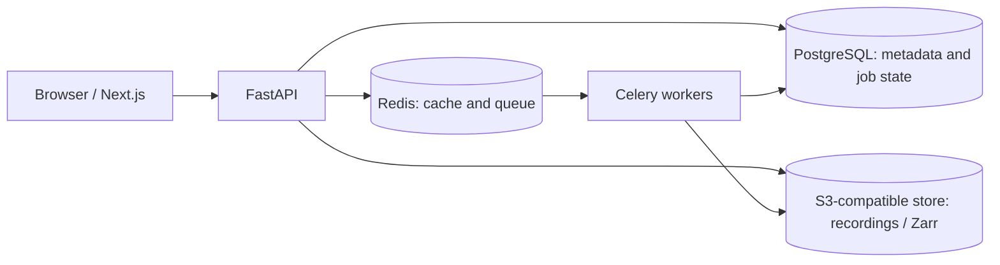

# NeuroWorkspace

[](https://github.com/vishalvinjamuri27/NeuroWorkspace/actions/workflows/ci.yml)

**Inspect, annotate, and process EEG recordings in your browser.**

NeuroWorkspace is a research-focused workspace for large electrophysiology recordings. It provides a multichannel waveform viewer, annotation and quality-control tools, and versioned processing without requiring researchers to load an entire recording into the browser.

> **Research alpha.** Not a medical device or diagnostic tool. Do not upload identifiable or regulated health information. See [Limitations](#limitations).


## Try it locally

**Requires:** Docker and Docker Compose, plus an internet connection for the checksum-verified public demo recording on first startup.

```bash
git clone https://github.com/vishalvinjamuri27/NeuroWorkspace.git
cd NeuroWorkspace
cp .env.example .env
docker compose up --build
```

Open **http://localhost:3000** and select **Try a sample EEG**. The demo uses a public, CC0-licensed EEGLAB recording from [OpenNeuro ds004362 v1.0.0](https://openneuro.org/datasets/ds004362/versions/1.0.0); no account or personal data upload is required to explore it.

To stop the stack, run `docker compose down`. To reset **all local data and volumes**, run `docker compose down -v`.

## What you can do

- **Explore large recordings:** pan, zoom, jump to a timestamp, and toggle channels. The viewer retrieves only the visible time window rather than downloading the entire signal.
- **Review and annotate:** label time ranges, flag bad channels, and use transparent QC heuristics. Optimistic concurrency prevents one editor from silently overwriting another's annotation changes.
- **Import real EEG files:** EDF/EDF+, BDF, BrainVision, EEGLAB (`.set`/`.fdt`), FIF, and configured CSV/TSV. Format acceptance tests use checksum-pinned public fixtures; see the [test data manifest](testdata/README.md).
- **Run nondestructive processing:** average re-referencing creates a new recording version with a link to its source instead of overwriting the original.
- **Export results:** annotations, QC summaries, and processing provenance.
- **Organize work:** use workspaces and projects, with membership-based access controls for private recordings. The sample recording is intentionally public.

## Architecture



This is a **modular monolith**, not a collection of microservices. The API handles authorization and metadata; background workers ingest and process signals; shared Python domain modules implement format adapters, QC, storage, and job coordination.

The important tradeoffs are:

1. **Store signal arrays separately from metadata.** Chunked Zarr objects support bounded, viewport-sized reads; PostgreSQL handles relational state and access control.
2. **Make background work recoverable.** A durable job row is committed before broker dispatch. Workers use a conditional database claim; a periodic sweep redrives jobs that were never dispatched or whose broker message was lost, and reclaims expired leases.
3. **Preserve scientific provenance.** Processing creates immutable output versions linked to the input version, and retains the original.
4. **Prevent silent write conflicts.** Annotation edits use revision checks and return a conflict rather than overwriting concurrent changes.

For implementation details, see [Architecture](docs/ARCHITECTURE.md) and [Data model](docs/DATA_MODEL.md).

## Validation and performance

These were measured on a single development machine (local Docker and MinIO), not under real user traffic, so read them as evidence of design properties rather than production capacity:

| Test | Observed result | Scope |
|---|---|---|
| Job claim contention | 32,000 claim attempts; zero duplicate claims | 16 worker threads contending on already-running jobs in PostgreSQL |
| Database scale | ~8.4 million seeded rows | Deterministic synthetic dataset used for query-plan/index evaluation |
| Fixed viewport query | ~7–8 ms warm response | Same 10-second, 2-channel window against 30-second, 5-minute, and 30-minute S3-backed recordings on a local stack |
| Runtime workflows | Upload, ingestion, QC, annotation, processing, export, and persistence exercised | Live Docker Compose stack and browser/API test clients |

The test environment, exact commands, additional results, and limitations are recorded in [Performance](docs/PERFORMANCE.md).

Every push runs the [CI workflow](https://github.com/vishalvinjamuri27/NeuroWorkspace/actions/workflows/ci.yml): unit and integration tests (including cross-connection race tests against PostgreSQL), Playwright browser tests, a check that the generated API types match the code, dependency audits, and a full Docker Compose run covering restart persistence, worker loss, and deletion cleanup.

## Repository layout

| Path | Purpose |
|---|---|
| `apps/web` | Next.js application and Canvas waveform viewer |
| `apps/api` | FastAPI routes and runtime initialization |
| `apps/worker` | Celery entrypoint and scheduled recovery tasks |
| `packages/signal-core` | Scientific adapters, domain logic, storage, processing, jobs |
| `packages/shared-types` | Generated OpenAPI client types |
| `tests`, `testdata` | Automated tests and pinned public fixture manifest |
| `deploy/helm` | Kubernetes manifests for local/infrastructure deployment experiments |

## Development

The Docker Compose path above is the recommended first run. For local development, install Python 3.12–3.13, Node.js 22.13+, `uv`, and `pnpm` 11 (`corepack enable` provides the pinned version); see [Contributing](CONTRIBUTING.md) and the [deployment guide](docs/DEPLOYMENT.md) for environment configuration.

```bash
make install       # install locked Python and JS dependencies
make lint          # Ruff + ESLint
make typecheck     # mypy + TypeScript
make test          # Python and frontend tests
make test-e2e      # Playwright browser tests
make real-data     # pinned public-EEG acceptance tests (downloads fixtures)
```

## Deployment status

Docker Compose is the supported local evaluation path. A Helm chart has been exercised on a local `kind` Kubernetes cluster, including installation, upgrades, and multi-replica API behavior. It **has not** been validated on a production-grade cloud cluster or against independently managed Postgres, Redis, and S3 services. See [Deployment](docs/DEPLOYMENT.md).

## Limitations

- **Non-clinical alpha only:** no diagnostic claims, no PHI support, and no formal external security audit. See [Security](SECURITY.md).
- **Not production-hosted:** no production cloud deployment or automated backup/restore system has been verified.
- **Limited processing:** average reference is the currently implemented processing operation; other transforms are not shipped.
- **Local measurements:** load tests and data-access benchmarks were run against local Docker/MinIO, not at production user scale. The shipped single-process API has a documented concurrency bottleneck.
- **Some operations are API-only:** for example, workspace membership administration is not yet available in the UI.

## Contributing

See [CONTRIBUTING.md](CONTRIBUTING.md). New format support should include a checksum-pinned independent public fixture and an acceptance test; numerical processing changes should document units, tolerance, and provenance.

Report security issues privately using the instructions in [SECURITY.md](SECURITY.md).
