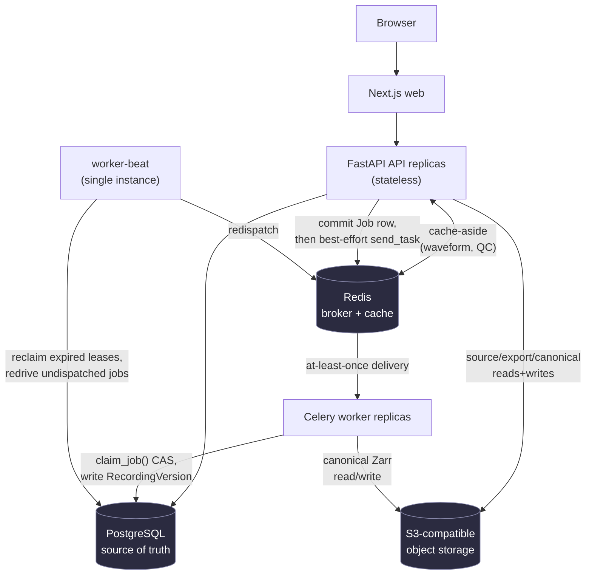

# Architecture

## Repository layout

```text
apps/web                  Next.js client and Canvas waveform viewer
apps/api                  FastAPI entrypoint and container
apps/worker               Celery worker entrypoint and container
packages/signal-core      Python domain logic, format adapters, storage, QC, processing
packages/shared-types     Generated OpenAPI TypeScript types
docs, deploy, scripts, tests, testdata
```

Python uses a root `pyproject.toml` and a `uv` lock file. pnpm manages the
frontend workspace. Containers are non-root, multi-stage builds. Local
development runs everything through `docker-compose.yml` (web, API, worker,
worker-beat, PostgreSQL, Redis, MinIO).

### Module boundaries inside `packages/signal-core`

- `domain` — entities, enums, policies, error types. No framework imports.
- `adapters` — the `RecordingAdapter` registry and format implementations
  (MNE-backed formats, CSV).
- `signal_store` — immutable, versioned Zarr storage and envelope pyramids.
- `qc` — pure metric functions and a rule registry.
- `processing` — validated operations that produce new recording versions.
- `services` — use cases: authorization, transactions, object storage, jobs.
- `db` — SQLAlchemy models and session management.

The API layer (`apps/api`) and worker layer (`apps/worker`) are thin
adapters around this shared package — routes validate input, call a
`services` function, and map the result/exception to an HTTP response; they
do not contain scientific or authorization logic themselves. Adding a format
adapter, QC rule, export format, or processing operation follows the same
shape: implement it against the relevant registry, add tests, and it's live
— no route or worker-task code changes needed for the addition itself.

## Component overview



PostgreSQL is the single source of truth for metadata, lineage, authorization,
job state, and annotations. Redis is a cache and broker only — nothing lives
there that can't be reconstructed from Postgres/S3. Every component above is
horizontally replicable except `worker-beat`, which runs as one instance by
design (see "Job dispatch and recovery" below).

A few of the choices behind this shape:

- **A modular monolith, not microservices** — one Next.js app, one FastAPI
  app, one Celery worker sharing the `signal-core` domain package. Nothing
  about this product's current scale justifies independently-deployed
  services, and keeping "create a Recording and its ingestion Job" one
  transaction is simpler than a distributed saga.
  ([ADR 0001](adr/0001-monorepo-modular-monolith.md))
- **Signal arrays live in object storage, not Postgres** — large,
  chunk-accessed data belongs somewhere built for that access pattern, not
  in the relational store used for metadata and authorization.
  ([ADR 0002](adr/0002-canonical-signal-storage.md),
  [ADR 0007](adr/0007-object-store-canonical-signal-storage.md))
- **Processing never mutates a recording in place** — a transformation
  produces a new, immutable version with a link to its parent, so the
  original is never at risk and the history of what was done is always
  reconstructable.
- **Job delivery is at-least-once; job effects are effectively-once** — a
  single conditional database update makes a duplicate task delivery a
  no-op, which is simpler to reason about than requiring exactly-once
  delivery from the broker itself.
  ([ADR 0004](adr/0004-job-queue.md))

## Upload and ingestion lifecycle

The client requests a presigned URL and uploads bytes **directly to
S3-compatible object storage** — the API never proxies the file body.
Calling `POST /uploads/{id}/complete` creates a `Recording` row and a
durable `Job` row (`kind=INGEST`) in one database transaction, then the API
*tries* to dispatch the job to Celery — but the durable record of "this work
needs to happen" is the `Job` row, not the dispatch attempt (see "Job
dispatch and recovery" below). A Celery worker claims the job with a single
conditional `UPDATE` (`claim_job()`), parses the file with the appropriate
adapter (`packages/signal-core/.../adapters/`), writes canonical Zarr arrays
plus multi-resolution pyramids to object storage, and creates an immutable
`RecordingVersion` row pointing at that data. See
`apps/api/src/neuro_api/routes_uploads.py`'s `_dispatch_*` helpers and
`packages/signal-core/src/neuro_workspace/services/jobs.py::claim_job`.

## Signal storage and viewport-bounded retrieval

Each immutable `RecordingVersion` is stored as:

```text
canonical/<version_id>/manifest.json          hashes, shapes, units, provenance
canonical/<version_id>/metadata.json
canonical/<version_id>/signals.zarr/raw               float32 [channel, sample]
canonical/<version_id>/signals.zarr/envelopes/L<k>     float32 [channel, bin, min|max]
```

chunked by `(channel, time-window)`, with several pre-computed
lower-resolution pyramid levels (min/max/valid-count envelopes) alongside
the raw data. A viewport request (`GET /recordings/{id}/waveform`) picks
the pyramid level matching the requested pixel width, then reads only the
object-storage chunks intersecting the requested time/channel range via
Zarr's `oindex` — never the full array. Query cost is proportional to
visible channels and viewport bins, not recording duration. This is why an
identical 10-second request against a 30-second and a 30-minute recording
measured the same ~7-8ms once warm (see
[PERFORMANCE.md](PERFORMANCE.md), "Viewport performance"). Read
`packages/signal-core/src/neuro_workspace/signal_store.py::query()`.

**Pyramid construction**: level-zero source values are partitioned into
adjacent bins of four samples. For level `k`, bin `j` covers source indices
`[j*4^(k+1), min((j+1)*4^(k+1), N))`; stored values are the exact finite min
and max, plus an all-nonfinite marker. Each next level combines four
previous bins using minimum-of-minima and maximum-of-maxima, so every finite
source extremum is represented at every covering level. Property tests
cover coverage, boundary conditions, NaN handling, monotonic ranges, and
slice equivalence.

## Processing lineage and version immutability

Every transformation (currently: average-reference) reads one
`RecordingVersion`'s canonical data and writes a **new** `RecordingVersion`
row with `parent_version_id` pointing at its input — never overwriting the
original. This makes lineage a directed graph queryable straight from
Postgres (`ix_recording_versions_recording_created`), makes an immutable
version's cache key never need invalidation (only a TTL), and means a bug in
a processing operation can corrupt at most the *new* version, never the
input. See [ADR 0002](adr/0002-canonical-signal-storage.md) and
`neuro_workspace/db/models.py::RecordingVersion`.

## Optimistic concurrency on shared mutable state

Two clients reading the same `Annotation` row both see `revision=1` and both
`PATCH` with `revision=1`. The write is a conditional `UPDATE ... WHERE
revision = :revision`; one succeeds (revision becomes 2), the other's `WHERE`
clause matches zero rows and the API returns `409
annotation_revision_conflict` with the current server state — never a silent
overwrite. `BadChannel` review uses the identical pattern. This was verified
against two real concurrent HTTP clients, not just unit-tested.
Code: `services/access.py`'s update paths; tests:
`tests/python/test_annotation_concurrency.py`.

## Job dispatch and recovery

**Duplicate delivery**: nothing observable happens — the second delivery is
a cheap no-op. `claim_job()` is a single conditional `UPDATE jobs SET
status='RUNNING', ... WHERE id=:id AND (status='QUEUED' OR (status='RUNNING'
AND lease_expires_at < now()))`. The first delivery's claim matches and
proceeds; the second delivery's identical `UPDATE` matches zero rows (the
job is already `RUNNING` with a live lease) and the worker returns
immediately. This is an *effectively-once* guarantee built on Celery's
at-least-once delivery — not a stronger, broker-level exactly-once
guarantee, and the documentation and tests are deliberately worded that way.
Proven under genuine concurrent Postgres connections, not just interleaved
calls on one connection — 32,000 claim attempts across 16 real worker
threads, zero double-claims (see [PERFORMANCE.md](PERFORMANCE.md)) — and
live, by sending a real duplicate task message.

**Worker death**: the job's row carries a `lease_expires_at`, refreshed
periodically while the worker is alive (`LeaseHeartbeat`). If the worker is
killed (SIGKILL, OOM, node failure), the lease simply expires. `worker-beat`'s
sweep (`run_dispatch_sweep` → `reclaim_expired_leases`) finds jobs `RUNNING`
past their lease, atomically resets them to `QUEUED` (a compare-and-swap,
not a blind `UPDATE`, to prevent two overlapping sweeps from
double-reclaiming the same job), and it gets redriven with no manual
intervention, bounded by `DEFAULT_LEASE_SECONDS`. Test:
`test_job_concurrency.py::test_concurrent_reclaim_sweeps_do_not_double_reclaim_the_same_job`.

**Broker outage between commit and dispatch**: the API commits the `Job` row
in the same transaction as the domain change, then makes a best-effort
attempt to notify Celery. If that notification fails (Redis down, network
partition), the request still succeeds — the `Job` row is the durable record
of work, not the broker message. `worker-beat`'s outbox sweep
(`find_undispatched_jobs`) picks up any `Job` left undispatched once the
broker is reachable again.

## Cursor pagination

The cursor is `(sort_column, id)`, not a row count. `OFFSET n` degrades
because Postgres has to scan and discard `n` rows every time, and it also
gives *wrong* results under concurrent inserts (a row inserted before the
current offset silently shifts every later page). Keyset pagination anchors
to the last row actually seen and asks the index for "the next N rows after
this key" — a plain index range scan regardless of depth. Measured directly:
walking 301 pages / 60,002 rows gave 2.55-40.30ms per page with no growth
trend. Code: `packages/signal-core/src/neuro_workspace/pagination.py`.

## Tenant isolation

Every query that touches workspace-scoped data is routed through
`services/access.py`, which resolves the caller's `Identity` to active
workspace memberships and role capabilities before the query runs — there is
no code path that queries `recordings`/`annotations`/etc. by ID alone without
also filtering by the caller's membership. A recording that exists but
belongs to a workspace the caller isn't a member of returns the same `404` as
a recording that doesn't exist at all, so existence can't be probed (see
[ADR 0005](adr/0005-authentication-authorization.md) — this is a deliberate
choice, "denials are uniform," not an oversight: a member with insufficient
role capability gets the same `404` as a non-member). This was verified live across two
independent API replicas with two different signed-in users.

## API conventions

Resources live below `/api`. IDs are opaque UUID strings. Lists paginate
with opaque cursors, never raw offsets. Mutations that can be safely retried
accept an `Idempotency-Key`. Annotation/bad-channel writes use a
revision precondition (optimistic concurrency, see above). FastAPI generates
the OpenAPI schema directly from the route/model definitions — browse it at
`/docs` (Swagger UI) or `/openapi.json` against a running API; CI checks
the generated TypeScript client types (`packages/shared-types`) for drift
against that schema.

Job progress uses bounded polling (`GET /jobs/{id}`, `Retry-After`) rather
than a push channel — a deliberate choice to avoid the connection/proxy/auth
overhead of SSE or WebSockets until measured polling load or UX actually
requires it ([ADR 0006](adr/0006-api-progress.md)).

Common status codes: `400`/`422` invalid input, `401` not signed in, `403`
role-insufficient (used only once existence is already established through
membership — see "Tenant isolation" above), `404` missing or unauthorized,
`409` optimistic-concurrency conflict, `5xx` internal/dependency failure
(always with a `diagnostic_id` in the response body for cross-referencing
server logs).

## Measured bottlenecks and what wasn't one

The database was never the bottleneck under load: Postgres CPU stayed under
3% at 40 concurrent virtual users. The actual bottleneck is that the shipped
API image runs a single uvicorn process — it measured at 257% CPU (2.5
cores) under load, with tail latency growing roughly linearly with
concurrency while throughput barely moved (11.9 → 25.1 req/s across a 50x
increase in VUs). Confirmed by running the same test with `--workers 2`: CPU
usage and throughput both increased proportionally — evidence the fix is
more server-side process concurrency (more uvicorn workers, or more
replicas — both already supported), not a database or code change. What
*didn't* turn out to be a problem despite being checked directly: query
plans at 8.4M rows (all sub-5ms, no seq scans), pagination depth, cache-key
correctness, and job-claim correctness under real concurrent connections.
See [PERFORMANCE.md](PERFORMANCE.md).

## Horizontal scaling

The API and worker are both stateless: no server-side session store (a
signed cookie carries identity), no replica-local cache of mutable state
(Redis is a shared cache, not per-replica), and no shared filesystem (signal
data is read/written directly against S3-compatible object storage by
whichever replica handles a request). This was proven, not just designed:
two independent API containers were brought up with no shared state, and a
session created against one was accepted by the other with identical
behavior, and the same statelessness was re-verified at 1/2/3 replicas on a
local `kind` Kubernetes cluster. The one
deliberately non-scaled component is `worker-beat` (the outbox sweep) — it
runs as a single instance because its job (finding undispatched/lease-expired
rows) is naturally idempotent under overlap, so a second instance briefly
running during a rolling deploy just races harmlessly on the same atomic
`UPDATE`s everything else uses, rather than needing leader election.

## Known scaling limits

- **API concurrency**: the shipped single-process API image is the measured
  bottleneck at moderate concurrency (see "Measured bottlenecks" above).
  Running multiple uvicorn workers per replica, or more replicas, is the
  documented fix.
- **Connection pool ceiling vs. replica count**: each API process holds up
  to 30 Postgres connections (`pool_size=10 + max_overflow=20`); against
  Postgres's default `max_connections=100`, that's roughly 3 replicas before
  headroom runs out. Scaling further needs a larger `max_connections`, a
  smaller per-replica pool, or a connection pooler (PgBouncer) in front of
  Postgres — none of which is implemented, since no benchmark here reached
  that many replicas. See [PERFORMANCE.md](PERFORMANCE.md).
- **A production-grade cluster** (EKS/GKE/AKS) with externally-provisioned
  Postgres/Redis/S3 has not been exercised — only a local `kind` cluster
  has.
- **Queue-depth-based worker autoscaling** would be a more accurate scaling
  signal than CPU for a job worker, but needs a cluster-level dependency
  (e.g. KEDA) not currently validated here.

## Authentication and authorization

Core domain code depends on an `Identity` abstraction, not a specific auth
vendor. Local development exchanges a known email for a signed, HTTP-only,
`SameSite=Strict` session cookie; hosted deployments plug in an OIDC
verifier without changing any domain policy code, and development auth is
refused outside local/dev environments. Every resource lookup joins through
active workspace membership — there is no bare `get(id)` exposed to routes
— and role capabilities (`owner`/`member`/`viewer`) are centralized in
`domain.py` rather than checked ad hoc per route.
