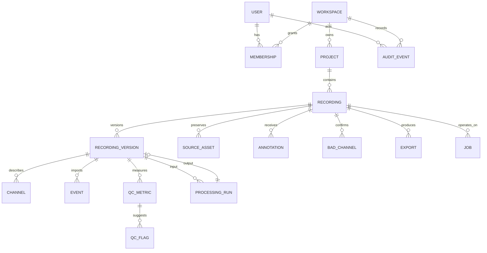

# Data model

All public IDs are opaque UUIDs. Rows include `created_at` and `updated_at`; scoped
entities include `workspace_id` even when derivable so authorization predicates
and indexes remain explicit. Scientific arrays live in object storage.



## Identity and collaboration

- `User`: external subject, safe display name, email-normalized identity, status.
- `Workspace`: name, slug, lifecycle, owner semantics.
- `Membership`: user/workspace, role owner/admin/member/viewer, status; unique pair.
- `Project`: workspace, name, description, lifecycle.

Owners manage billing-equivalent/destructive workspace actions; admins manage
members/projects; members create/edit scientific resources; viewers read. Export
and original-download permissions can be tightened independently later.

## Recording aggregate

- `Recording`: stable logical identity, project/workspace, display name, format,
  lifecycle state, active version, source provenance summary, safe metadata, demo
  marker, deletion timestamp.
- `SourceAsset`: immutable key, original safe basename, role (primary/header/
  marker/data/sidecar), byte size, SHA-256, media sniff, upload ID. Sensitive
  header values are not promoted here.
- `RecordingVersion`: kind raw-normalized/derived, parent version, store prefix,
  manifest hash, sampling frequency/timebase, samples, duration, software build,
  immutable ready time.
- `Channel`: version, stable index, source/name, type, physical unit, source unit,
  conversion factor, optional sample rate, location reference, safe extra metadata.
- `Event`: version, onset seconds/sample, duration, code, safe label, source index,
  provenance. Imported events are immutable for that version.
- `Annotation`: recording, optional version/timebase, onset, duration, label,
  description, creator/updater, provenance kind, optimistic revision, deleted time.
- `BadChannel`: recording/version/channel, state confirmed-bad/confirmed-good,
  actor, reason, revision. Absence means unreviewed.

## Computation and provenance

- `QCMetric`: version, rule ID/version, scope recording/channel/window, numeric
  value/unit, parameters, computed time.
- `QCFlag`: metric, severity review/info, threshold and comparison, safe message,
  state algorithmic/dismissed/confirmed, reviewer where applicable.
- `ProcessingRun`: input version, operation ID/version, canonical JSON parameters,
  creator, job/status, software/container version, output version, error reference.
- `Export`: requested format/options, source version, annotation snapshot revision,
  object/hash/size, expiry, conversion and loss notes, creator/job/status.
- `Job`: kind, subject type/ID, idempotency key, state, attempt/max attempts,
  progress/stage, safe error code/message, diagnostic ID, lease/heartbeat times.
- `AuditEvent`: workspace, actor, action, target opaque IDs, safe structured fields,
  request correlation. It never stores signal values or annotation contents.

## State machines

Recording states:

```text
CREATED -> UPLOADING -> UPLOADED -> QUEUED -> INGESTING -> PROCESSING -> READY
                                       \-------------------------------> FAILED
any non-deleted state -> DELETING -> DELETED
```

Retrying a failed recording creates/reattaches a new job while retaining safe
failure history. `READY` points only to a validated immutable manifest.

Jobs use queued/running/succeeded/failed/cancel-requested/cancelled. Uploads use
created/uploading/completed/aborted/expired. Invalid transitions fail at the domain
boundary and are covered by tests.

## Indexes and constraints

- Unique membership `(workspace_id, user_id)` and channel `(version_id, index)`.
- Unique active idempotency key per workspace/use case.
- Recording/project lists on `(workspace_id, project_id, created_at, id)`.
- Jobs on `(status, available_at, priority)` and `(subject_id, kind, status)`.
- Events/annotations on `(recording_id, onset_seconds)`.
- Check nonnegative onset/duration/sample counts and positive sample rates.
- Processing output points to exactly one successful run; raw source remains a
  root. Deletion tombstones are never hard-deleted before delayed-job retention.

## Metadata policy

Normalized safe metadata uses typed columns for common facts and namespaced JSON
for interoperable details (`bids`, `mne`, `source`). Unknown headers remain only
in protected originals or a restricted ingestion report. No patient/subject name,
birth date, free-text hospital field, or source path is copied into the normal UI.

